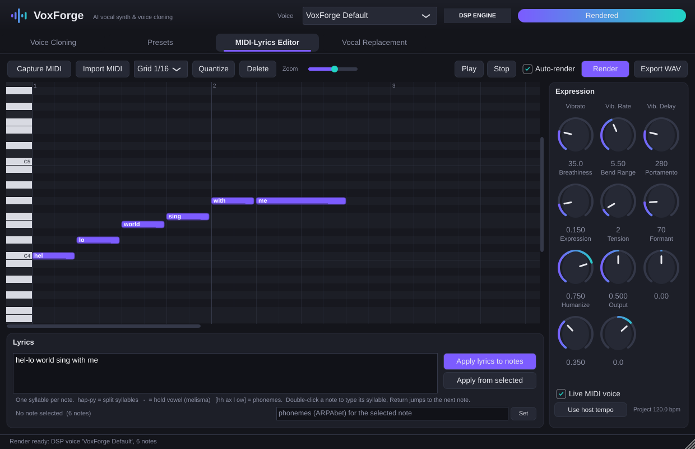

# VoxForge: AI vocal synth VST3 with voice cloning

VoxForge is a Windows x64 **VST3 instrument**, inspired by ACE Studio, that sings MIDI and lyrics
in **your own cloned voice** and can **replace an existing vocal**. Rendering is local and offline.
It works in Cubase, Nuendo, FL Studio, Ableton Live, Studio One and Reaper at 44.1–192 kHz.



## Features

- **Voice cloning.** Drop in dry recordings of your singing. A *Lite clone* is ready in seconds
  (vocal-tract length, spectral fingerprint, breathiness, vibrato habits, range). Optional
  **neural training** (NSF-HiFiGAN voice conversion, 10–30 min of singing, NVIDIA GPU) upgrades
  it to your real timbre. Every voice is saved as a named preset.
- **MIDI → singing.** Capture the MIDI part from the DAW, import a `.mid` file, or draw notes.
  Type lyrics: syllables are aligned to notes automatically, with melisma (`-`), syllable splits
  (`hap-py`) and explicit phonemes (`[hh ax l ow]`). Controls for vibrato depth, rate and delay,
  breathiness, pitch-bend range, portamento, expression, tension, formant and humanize. Captured
  pitch bend, CC1, CC2 and CC11 are used too.
- **Vocal replacement.** Load a vocal stem. Built-in **Vocal-to-MIDI** and offline **lyrics
  extraction** (Whisper) turn it into editable notes and words. Change the melody or the words,
  then re-render in your cloned voice. Unchanged words keep the original articulation; new
  words are synthesised. A/B monitoring against the original and WAV export are included.
- **Applio / RVC voices**: import any RVC v2 voice model trained in Applio or RVC WebUI (32/40/48 kHz)
  and sing it from MIDI or use it for vocal replacement.
- **Preset manager**: use, rename, duplicate, delete, import and export voices as `.vfvoice`
  files, and save expression settings into a preset.
- A real-time **live MIDI voice** for auditioning, and offline high-quality renders for playback
  and export.

## Documentation

- **[User manual](docs/USER_MANUAL.md)**: installation, the three workflows, parameters,
  per-DAW setup, troubleshooting
- **[Build instructions](docs/BUILD.md)**: Windows VST3 build, ONNX Runtime, CI, installer, engine
  packaging, tests
- **[Architecture](docs/ARCHITECTURE.md)**: synthesis, cloning, neural model contract, Vocal-to-MIDI,
  threading

## Quick start (Windows)

```powershell
cd VoxForge
powershell -ExecutionPolicy Bypass -File scripts\build_windows.ps1 -Install   # builds + installs VoxForge.vst3
powershell -ExecutionPolicy Bypass -File scripts\install_engine.ps1           # optional: neural training + lyrics extraction
```

You can also download the `VoxForge-win-x64` artifact from the **VoxForge (Windows x64 VST3)**
GitHub Actions workflow.

## Status and honest limitations

- The DSP engine, Lite cloning, Vocal-to-MIDI, the editor and DAW integration are complete. They
  are covered by automated tests: engine tests, plus a host test that loads the `.vst3`.
- **Base model:** neural voices are fine-tuned from the official pretrained **RVC v2 48 kHz** base
  model (MIT license, trained by the RVC project on about 50 h of the multi-speaker VCTK corpus).
  The engine downloads it automatically (~220 MB) and uses the exact RVC v2 architecture, so a few
  minutes of your singing are enough for a natural clone. You can swap in any RVC v2 48 kHz
  compatible base, including a singing-specialised one you pre-train yourself
  ([BUILD.md → Base model](docs/BUILD.md#base-model-for-high-quality-neural-voices)).
- Use only your own voice, or voices you have permission to clone.
