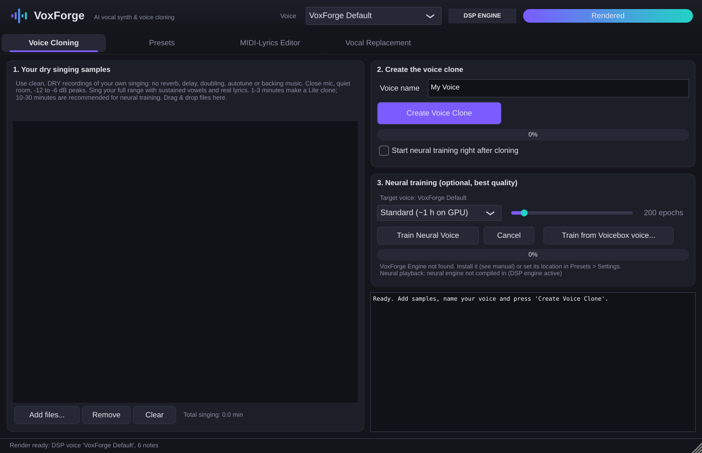
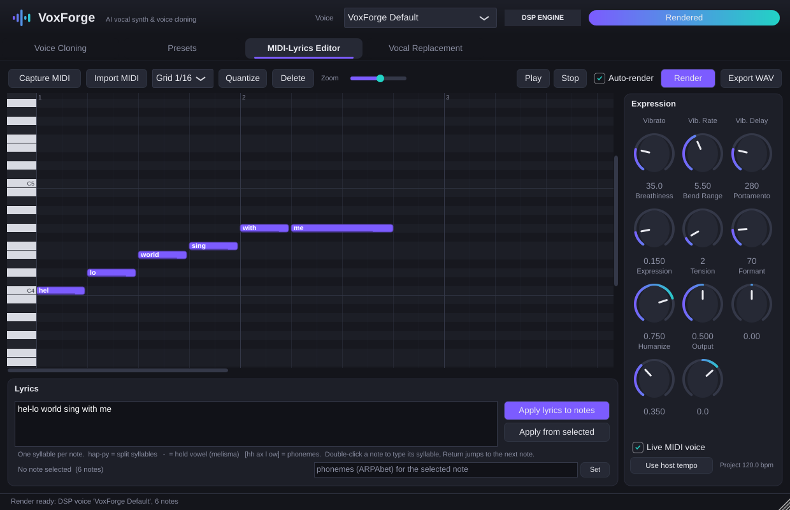
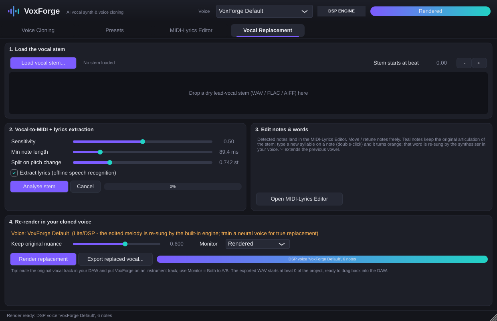
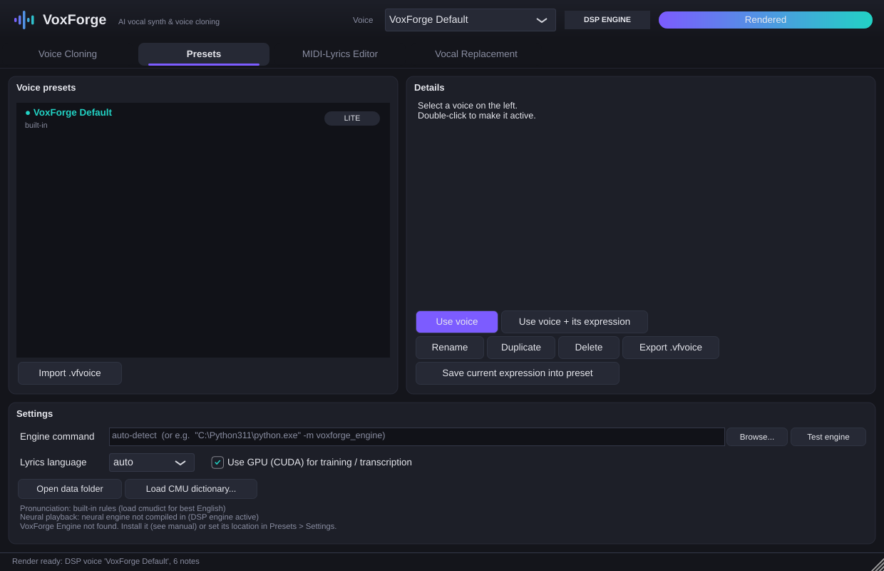

# VoxForge user manual

VoxForge is a VST3 instrument that sings. You give it MIDI notes from your DAW
and typed lyrics, and it sings them in **your own cloned voice**. It can also
take an existing vocal recording, turn it into editable notes and words, and
re-sing it in your voice.

All processing runs locally on your computer. Nothing is uploaded.

- [1. Installation](#1-installation)
- [2. The two engines: Lite and Neural](#2-the-two-engines-lite-and-neural)
- [3. Workflow A: clone your voice](#3-workflow-a--clone-your-voice)
- [4. Workflow B: sing from MIDI and lyrics](#4-workflow-b--sing-from-midi--lyrics)
- [5. Workflow C: replace an existing vocal](#5-workflow-c--replace-an-existing-vocal)
- [6. Presets](#6-presets)
- [7. Parameters](#7-parameters)
- [8. DAW setup (Cubase, Nuendo, FL Studio, Ableton Live, Studio One, Reaper)](#8-daw-setup)
- [9. Lyrics syntax](#9-lyrics-syntax)
- [10. Troubleshooting](#10-troubleshooting)
- [11. Limits and good practice](#11-limits--good-practice)

---

## 1. Installation

### Plug-in

1. Copy **`VoxForge.vst3`** (the whole folder) to `C:\Program Files\Common Files\VST3\`,
   or run `VoxForge-Setup-x64.exe`.
2. If your package includes `onnxruntime.dll` / `onnxruntime_providers_shared.dll`, they
   are already inside `VoxForge.vst3\Contents\x86_64-win\`. Leave them there. VoxForge
   loads its own copy, which avoids clashes with the older one Windows keeps in `System32`.
3. Rescan plug-ins in your DAW. VoxForge appears as an **instrument** from *Bawmer*.

VoxForge works at every sample rate from **44.1 kHz to 192 kHz**. Rendering happens
inside at 48 kHz and is resampled with high quality to your project rate.

### VoxForge Engine (optional, needed for neural voices and lyrics extraction)

The engine is a separate local program built on PyTorch. It trains neural voices
and transcribes lyrics. The plug-in launches it in the background when needed.

1. Install **Python 3.10, 3.11 or 3.12 (64-bit)** from python.org. Tick *Add to PATH*.
2. Run `install_engine.ps1`: right-click it, choose *Run with PowerShell*, or use the
   start-menu entry *Install VoxForge Engine*. The script:
   - creates `%APPDATA%\VoxForge\engine-venv`
   - installs PyTorch, the CUDA build if an NVIDIA GPU is found
   - exports the shared content encoder to `%APPDATA%\VoxForge\Models\content_encoder.onnx`
   - downloads the CMU pronunciation dictionary
3. Re-open VoxForge. Go to **Presets → Settings → Test engine**. It should report
   `Engine OK`.

You can also point VoxForge at any engine in *Presets → Settings → Engine command*,
for example `"C:\Python311\python.exe" -m voxforge_engine`.

Folders VoxForge uses (`%APPDATA%\VoxForge`):

| Folder / file | Contents |
|---|---|
| `Voices\<name>\` | One folder per cloned voice: `voice.json`, `samples\`, `voice.onnx` (neural) |
| `Models\` | `content_encoder.onnx`, `base\f0G48k.pth` + `f0D48k.pth` (pretrained base), optional `base\base.pt`, Whisper models |
| `Cache\` | Rendered takes (the 12 most recent are kept) |
| `cmudict.dict` | Optional English pronunciation dictionary |
| `settings.xml` | Engine command, language, GPU switch |

---

## 2. The two engines: Lite and Neural

| | **Lite clone (DSP engine)** | **Neural voice** |
|---|---|---|
| Creating it | Instant (a few seconds of analysis) | Training: about 20 min to 3 h on an NVIDIA GPU |
| Material needed | 1–3 min of dry singing | 10–30 min of dry singing (more is better) |
| What gets cloned | Vocal-tract length (formants), spectral fingerprint, breathiness, vibrato habits, range | The full timbre and texture of your voice |
| Sound | Clear, synthetic "vocal synth" character | Natural, close to your real voice |
| Vocal replacement | Re-sings the edited melody with the synth | Keeps the original articulation and changes only notes and words you edit |
| Needs | Nothing | VoxForge Engine for training; a VoxForge build with the neural backend for playback |

Every clone starts as a Lite voice. You can upgrade it to Neural at any time with
the same samples. The header badge shows **NEURAL** or **DSP ENGINE** for the active voice.

> **Base model:** neural training does not start from zero. It fine-tunes the pretrained
> **RVC v2 48 kHz** base model (MIT license, trained on about 50 hours of many different voices).
> The engine installer downloads it to `Models\base\` (~220 MB); if it is missing, the first
> training downloads it. Because the base already knows how to produce a natural voice, 10–30
> minutes of your singing are enough. A singing-specialised base you train yourself
> (`Models\base\base.pt`) takes priority — see
> [BUILD.md → Base model](BUILD.md#base-model-for-high-quality-neural-voices).

---

## 3. Workflow A: clone your voice

**Recording tips.** Each one has a large effect on quality:

- Record **dry**: no reverb, delay, doubling, harmonies, auto-tune or backing track.
- Use a close mic in a quiet, dead room. Keep peaks between −12 and −6 dBFS, with no clipping.
- Sing your **whole range**, quiet and loud. Use real lyrics and sustained vowels.
  Include some phrases with and without vibrato.
- Use WAV, FLAC or AIFF at any sample rate. Mono or stereo both work; VoxForge mixes to mono.

**Steps**

1. Open the **Voice Cloning** tab. Drag your files onto the list or click **Add files…**.
   Each file is checked straight away and shows its duration, range, peak and any
   warnings (clipping, noise, reverb).
2. Type a **voice name**.
3. Click **Create Voice Clone**. VoxForge analyses the material, copies the samples into
   the preset folder, saves the preset and makes it the active voice. The log shows the
   detected range, vocal-tract scale, breathiness and vibrato.
4. Optional, for best quality: under **Neural training**, choose a quality level
   (*Fast*, *Standard* or *High*) or set the epochs yourself, then click
   **Train Neural Voice**. You can close the plug-in window and keep working: training
   continues in the background, with progress shown in the tab and the status bar.
   When it finishes, the preset becomes **NEURAL** and new renders use it.
   Training resumes from its last checkpoint if you run it again.

Tick *Start neural training right after cloning* to do steps 3 and 4 in one go.

---

## 4. Workflow B: sing from MIDI and lyrics

### Get notes into VoxForge

Choose one of these:

- **Capture from the DAW (recommended).** Put VoxForge on an instrument track that holds
  your melody as a MIDI clip. Click **Capture MIDI**, then press *Play* in the DAW and let
  the part play through. When you stop, the notes appear in the editor. VoxForge also
  records pitch bend, CC1 (mod wheel → vibrato), CC2 (breath) and CC11 (expression).
- **Import MIDI**: load a `.mid` file, or drag one onto the editor. VoxForge uses the track
  with the most notes.
- **Draw**: double-click empty space to add a note. Drag a note to move it, drag its edges
  to resize it, and use Shift+click or drag a rubber band to select several. Arrow keys
  transpose (Shift moves by an octave), Delete removes, Ctrl+A selects all, Ctrl+Q quantizes.
  Hold Alt while dragging to turn off the grid.

VoxForge sings one note at a time. Overlapping notes are trimmed when they are captured or imported.

### Lyrics

Type or paste lyrics in the **Lyrics** box and click **Apply lyrics to notes**. Each
syllable goes onto the next note. **Apply from selected** starts at the selected note.
To edit a single note, double-click it, type its syllable and press Return; the editor
jumps to the next note so you can type a whole line quickly. See
[Lyrics syntax](#9-lyrics-syntax) for holds, syllable splits and phonemes.

The bottom row shows the selected note's phonemes. To fix a pronunciation, type
ARPAbet phonemes there and click **Set**.

### Render

VoxForge renders **offline**, in the background, for best quality. With **Auto-render** on,
it re-renders about 0.7 s after each edit. **Render** forces a render. During DAW playback
the rendered vocal plays in sync with the timeline. **Play** and **Stop** preview the render
inside the plug-in, starting from the selected note. **Export WAV** writes the vocal,
starting at beat 0, at your project sample rate.

**Live MIDI voice**: while the DAW is stopped, or before anything is rendered, VoxForge also
sings incoming MIDI in real time, one syllable per note, so you can audition with a keyboard.
During playback, the render takes over.

> **Tempo:** notes are stored in beats. If you change the DAW tempo, the editor shows both
> tempos in orange. Click **Use host tempo** to re-render at the new tempo.

---

## 5. Workflow C: replace an existing vocal

1. **Load the stem.** In **Vocal Replacement**, click **Load vocal stem…** or drag a WAV,
   FLAC or AIFF file onto the waveform. Use a dry, solo lead vocal. Set **Stem starts at beat**
   to where the stem sits on your timeline (0 = bar 1).
2. **Analyse.** Click **Analyse stem**. VoxForge runs:
   - **Vocal-to-MIDI**: pitch tracking and note segmentation. *Sensitivity*, *Min note length*
     and *Split on pitch change* tune how many notes are found.
   - **Lyrics extraction**: offline speech recognition (Whisper, via the VoxForge Engine) pulls the
     words out of the recording with a timestamp for every word, and each word's syllables are
     placed on the notes sung at that moment. The transcript also appears in the Lyrics box.
     Tips for singing:
     - Choose the model in *Presets → Settings → Lyrics model*. *small* is the default; *medium* or
       *large-v3* are clearly better on sung vowels (slower, downloaded once).
     - Set *Lyrics language* if auto-detection picks the wrong language.
     - If you already know the lyrics, paste them in the editor's Lyrics box **before** analysing:
       they are given to the recogniser as a hint, which fixes most misheard words.
     - Without the engine, notes show `•` ("keep the original sound") and you type the words yourself.
3. **Edit.** Click **Open MIDI-Lyrics Editor**. The teal line is the original pitch. Notes are:
   - **teal**: unchanged words. These keep the original articulation and phrasing.
   - **orange**: words you changed. Double-click a note and type a new syllable. These parts
     are newly synthesised in your voice and blended in.
   - **violet**: notes you added.

   Move notes in time, retune them, and change lengths. The timing of the original is
   stretched to match.
4. **Re-render.** In step 4, click **Render replacement**.
   - **Keep original nuance** sets how much of the singer's own vibrato, scoops and bends
     stays on top of your edited melody.
   - **Monitor** switches between *Rendered*, *Original Stem* and *Both*, for A/B comparison.
   - **Export replaced vocal…** writes the new vocal as a WAV file that starts at beat 0.

With a **Neural** voice, true replacement happens: the words and articulation of the original
performance are re-sung in your timbre. With a Lite voice, the edited melody and lyrics are
sung by the built-in engine, and the header warns you about this.

In your DAW, mute the original vocal track and play VoxForge on an instrument track, or
import the exported WAV.

---

## 6. Presets

Each cloned voice is a named preset. The preset holds the timbre analysis, the neural model,
its training samples, and default expression settings.

- **Use voice**, or double-click it: makes it the active voice.
- **Use voice + its expression**: also loads the preset's vibrato, breathiness, tension and
  other expression settings.
- **Save current expression into preset**: stores your current knob settings in the preset.
- **Rename**, **Duplicate**, **Delete**.
- **Export .vfvoice** and **Import .vfvoice**: one file that contains everything, so you can
  move voices between computers or back them up.

The **voice selector** in the header switches voices from any tab. The DAW project remembers
which voice and which edits you used. Rendered takes are cached and restored instantly when
you reopen the project; if the cache is missing, VoxForge re-renders automatically.

**Settings** (bottom of the Presets tab):

- **Engine command**: where the engine is installed. Leave it empty to detect it automatically.
- **Lyrics language**: the speech-recognition language. *auto* works for most songs.
- **Lyrics model**: Whisper model size for lyrics extraction (tiny … large-v3).
- **Use GPU**: train and transcribe with CUDA.
- **Load CMU dictionary…**: improves English pronunciation (the engine installer does this for you).

---

## 7. Parameters

All parameters are automatable in the DAW and saved with the project. They are **render
parameters**: changing one re-renders the vocal (with Auto-render on). For movement over time,
use the MIDI controllers that VoxForge captures (pitch bend, CC1, CC2, CC11) or per-note edits.

| Parameter | Range | What it does |
|---|---|---|
| Vibrato | 0–150 cents | Vibrato depth. CC1 (mod wheel) adds up to 150 % more |
| Vib. Rate | 3–9 Hz | Vibrato speed. Varies slightly per note when Humanize is on |
| Vib. Delay | 0–1200 ms | How long a note is held before vibrato fades in |
| Breathiness | 0–1 | Aspiration noise and softer voicing. CC2 (breath) adds to it |
| Bend Range | 0–24 st | Pitch-bend range of captured or imported pitch-bend data |
| Portamento | 0–400 ms | Glide time between legato notes |
| Expression | 0–1 | Overall dynamics. CC11 and note velocity scale it |
| Tension | 0–1 | Soft and airy (0) to pressed and bright (1). Changes the glottal source and singer's formant |
| Formant | −6 to +6 st | Gender and size of the vocal tract, without changing pitch |
| Humanize | 0–1 | Natural pitch drift, onset scoops and vibrato variation |
| Original Nuance | 0–1 | Replacement only: how much of the original pitch movement is kept |
| Output | −24 to +12 dB | Output level |
| Live MIDI voice | on/off | Real-time voice from incoming MIDI when not playing back a render |
| Monitor | Rendered / Original / Both | Replacement A/B monitoring |

---

## 8. DAW setup

General rule: insert VoxForge as an **instrument**, keep your melody MIDI on that track, and
use **Capture MIDI** once (or import the MIDI file). After rendering, the vocal follows your
transport. VoxForge reports 0.5 s of tail. Because it renders offline, it adds no latency and
works with offline bounce and export.

| DAW | Setup |
|---|---|
| **Cubase / Nuendo** | *Project → Add Track → Instrument → VoxForge*. Put the melody part on that track. VoxForge also receives pitch bend and CCs: Cubase sends them as VST3 parameter changes and VoxForge maps them back to MIDI. For replacement, drag your vocal event to the file browser or *Audio → Export*, then load it in VoxForge with *Stem starts at beat* set to its position. |
| **FL Studio** | Add VoxForge from the *Plugin database → Generators* (or Channel Rack → +). Write the melody in the piano roll of the VoxForge channel and press Play with **Capture MIDI** armed. Enable *Make bridged* only if your FL version needs it; VoxForge is 64-bit. FL may start playback from the song position, so begin capture from bar 1. |
| **Ableton Live** | Drag VoxForge (*Plug-Ins → VST3*) onto a MIDI track. Arm **Capture MIDI** and play the clip from the arrangement start, or drop the `.mid` export of your clip onto the editor. Turn on *Configure → MIDI* only if you need to automate parameters. |
| **Studio One** | Drag VoxForge from *Browse → Instruments* into the arrangement. A MIDI track is created; draw or move your melody there. Stems can be dragged straight from Studio One's browser onto VoxForge's replacement tab. |
| **Reaper** | *Insert → Virtual instrument on new track → VST3: VoxForge (Bawmer)*. Put the melody item on that track. For replacement, right-click the vocal item → *Show in explorer*, then drag the file onto VoxForge. |

**Tips**

- Start capture from bar 1. VoxForge stores positions relative to the project start, so
  playback lines up anywhere afterwards.
- Most DAWs let you drag files onto plug-in windows (samples, MIDI files, stems, lyric `.txt`).
  If yours doesn't, use the buttons.
- Freeze or bounce the VoxForge track once you are happy with the vocal; this saves CPU.

---

## 9. Lyrics syntax

| Input | Meaning |
|---|---|
| `hello world` | Words are split into syllables automatically: `hel` `lo` `world` → 3 notes |
| `hap-py` | Explicit syllable split → 2 notes |
| `-` | Hold: continue the previous vowel on the next note (melisma). `love - -` sings "lo-o-ove" over 3 notes |
| `word-` | The word, then a hold on the next note |
| `[hh ax l ow]` | Explicit ARPAbet phonemes for one note |
| line breaks and punctuation | Ignored, so you can paste lyrics as they are |

ARPAbet vowels: `aa ae ah ao aw ax ay eh er ey ih iy ow oy uh uw`.
Consonants: `b ch d dh f g hh jh k l m n ng p r s sh t th v w y z zh`.

Consonants are timed like a real singer: the onset consonants of a syllable come **before**
the beat so the vowel lands on it, and final consonants close the note.

---

## 10. Troubleshooting

| Problem | What to do |
|---|---|
| No sound | Check there are notes in the editor and the status says *Rendered*. Press Play in the DAW. Check that *Monitor* is not set to *Original Stem* with no stem loaded, and that *Output* is not turned down. |
| Sound only while stopped | That is the Live MIDI voice. Render, or wait for auto-render, to hear the vocal during playback. |
| Vocal out of time | Capture or import from bar 1. If the DAW tempo changed, click **Use host tempo**. For replacement, check *Stem starts at beat*. |
| "Engine not found" | Run `install_engine.ps1`, or set *Presets → Settings → Engine command*, then click **Test engine**. |
| Lyrics extraction failed | Install faster-whisper (the engine installer does this). The first run downloads the Whisper model, so it needs internet once; after that it works offline. Choose the language in Settings if detection fails. |
| Training very slow | Use an NVIDIA GPU with *Use GPU* on, or the *Fast* quality level. On CPU only, use Lite clones. |
| Neural badge missing | The voice needs `voice.onnx`, the build needs the neural backend, and `Models\content_encoder.onnx` must exist. The Presets status lines show which one is missing. |
| Wrong pronunciation | Load the CMU dictionary, split syllables with `-`, or type phonemes for that note. |
| Clicks or artefacts in replacement | Raise *Min note length*, lower *Sensitivity*, merge tiny notes, and use a cleaner (drier) stem. |

---

## 11. Limits and good practice

- **Use only your own voice, or voices you have permission to use.** Cloning another
  person's voice without consent can be illegal and is against the intent of this tool.
- VoxForge sings English best. Other languages work through explicit phonemes, and through
  the neural replacement workflow, which keeps the original pronunciation.
- One voice per instance. Use several instances for harmonies and doubles.
- Expression parameters apply to the whole render. Use MIDI CCs and note edits for changes over time.
- Lite clones sound synthetic by design. For realism, train a neural voice, ideally from a base model.
