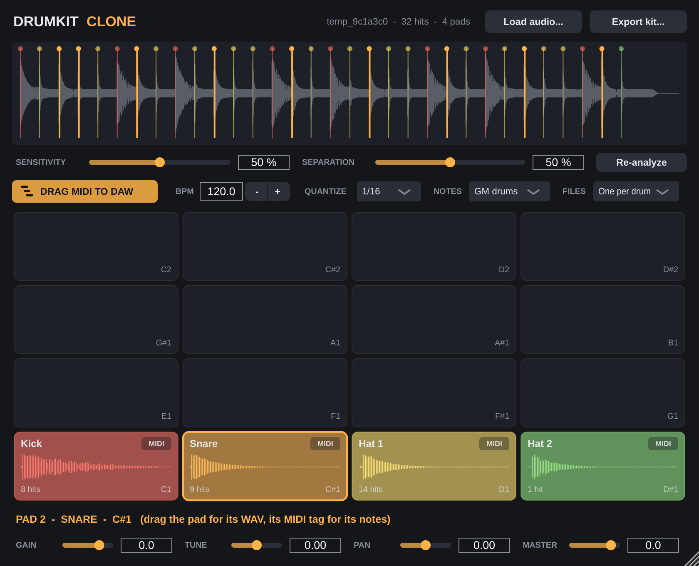

# Drumkit Clone

A VST3 instrument (plus AU on macOS and a standalone app). Drop a loop, a one-shot
or a whole song on it and it turns the audio into a kit: it finds every hit, groups
them by sound, isolates a one-shot of each group and lays them out on 16 pads,
ready to play from MIDI.



## Using it

1. Add **Drumkit Clone** to an instrument track.
2. Drag an audio file onto the window (or **Load audio...**). WAV, AIFF, FLAC, OGG
   and MP3 work everywhere; the first 10 minutes of a file are analysed.
3. Play. Pad 1 is **C1** (MIDI note 36) and the pads go up chromatically to D#2,
   bottom-left to top-right like a drum machine. Click a pad to audition it.

| Control | What it does |
| --- | --- |
| Sensitivity | Higher finds quieter hits (ghost notes, soft hats). Lower ignores them. |
| Separation | Higher splits similar sounds onto more pads; lower merges them. |
| Re-analyze | Runs the same file again with the current two settings. |
| Gain / Tune / Pan | Per pad, automatable. Tune is ±24 semitones. |
| Master | Output level. |
| Export kit... | Writes every pad as a 24-bit WAV into a `<name> Kit` folder, plus a `MIDI` folder with the pattern. |
| Drag a pad out | Drops that pad's WAV straight into the DAW or a folder. |
| **Drag MIDI to DAW** | Drops the loop's pattern as MIDI, one track per drum (see below). |
| MIDI tag on a pad | Drags just that drum's MIDI part. |

## Loop to MIDI tracks

After a loop is analysed, hold **DRAG MIDI TO DAW** and drop it on your DAW's track
area. Each drum becomes its own MIDI track (Kick, Snare, Hat...), with the hits at
the times they happen in the loop and velocities that follow the original dynamics.

| Option | What it does |
| --- | --- |
| BPM | Tempo the notes are written at. It is detected from the loop (a loop cut to whole bars gets its exact tempo); correct it here if it is wrong, e.g. half or double. |
| Quantize | Off keeps the groove; 1/8, 1/16 or 1/32 snaps notes to the grid. |
| Notes | **Pads**: C1 upwards, so the tracks play Drumkit Clone's pads. **GM drums**: Kick 36, Snare 38, Clap 39, Closed hat 42, Open hat 46, Toms 45-50, Crash 49, to drive any drum plugin. |
| Files | **One per drum** drops several `.mid` files at once (Kick.mid, Snare.mid...) - most DAWs (Ableton Live, Cubase, Studio One, Reaper, Bitwig, Logic) create one track per file. **Multi-track** drops one Type 1 `.mid` with a named track per drum, for DAWs that split multi-track files themselves. |

To hear the drums from the Drumkit Clone pads, route each new MIDI track to this
instance (or put a Drumkit Clone on each track with the same kit loaded - the
kit is saved per instance). With **GM drums** any GM-mapped drum instrument works.

The coloured markers on the waveform show which pad each detected hit went to.
The kit is saved inside the DAW project, so a session reopens with its pads even
if the original file is gone.

## How it works

1. **Find hits** - spectral flux over mel bands with an adaptive threshold, then
   each onset is moved onto the actual start of the attack.
2. **Group by sound** - every hit gets a level-independent spectrum and decay
   shape, with whatever was already sounding before the hit subtracted, and the
   hits are clustered. The 16 groups with the most hits become pads.
3. **Isolate** - for each group the most typical hit with the most room to ring
   is cut out. Two things clean it up: anything that was sounding just before the
   hit is spectrally subtracted, and where the group has three or more hits, only
   what those hits have in common is kept - so a bass note or vocal that happened
   to sit under one hit is removed.
4. **Name and lay out** - a rough guess (Kick, Snare, Clap, Hat, Open Hat, Tom,
   Perc, Cymbal) orders the pads.

What to expect: loops and drum stems come out clean. In a dense full mix, sounds
that always land together (a kick with the same bass note every time) end up on
one pad, and pitched instruments with sharp attacks can claim pads of their own.
This is signal processing, not a trained stem-separation model.

## Building

Needs CMake 3.22+ and a C++17 compiler. JUCE 8.0.4 is downloaded on first
configure (or pass `-DJUCE_PATH=/path/to/JUCE`).

```bash
cmake -S . -B build -DCMAKE_BUILD_TYPE=Release
cmake --build build --config Release
```

The plugin lands in `build/DrumkitClone_artefacts/Release/VST3/Drumkit Clone.vst3`.
Copy it to your VST3 folder, or add `-DDKC_COPY_AFTER_BUILD=ON` to have the build
do that:

- Windows: `C:\Program Files\Common Files\VST3`
- macOS: `~/Library/Audio/Plug-Ins/VST3`
- Linux: `~/.vst3`

Linux also needs `libasound2-dev libx11-dev libxrandr-dev libxinerama-dev
libxcursor-dev libxext-dev libfreetype-dev libfontconfig1-dev`.

The repository's **Drumkit Clone** GitHub Actions workflow builds Windows, macOS
(universal) and Linux bundles and attaches them to each run as downloadable
artifacts. They are unsigned; on macOS run
`xattr -cr "Drumkit Clone.vst3"` after downloading.

`build/DrumkitCloneTests_artefacts/Release/DrumkitCloneTests` is a self-test that
synthesises drum material and checks hit detection, grouping, isolation, MIDI
playback and state save/restore.

JUCE is used under its AGPLv3 / commercial licence terms; VST is a trademark of
Steinberg Media Technologies GmbH.
