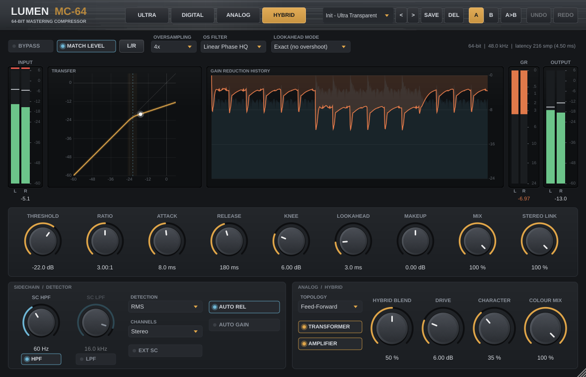

# Lumen MC-64 — 64-bit DSP mastering compressor

A transparent mastering compressor with a 64-bit (double-precision) signal path. It has
analog-inspired behaviour you can switch on when you want it. Written in C++17 with JUCE 8,
it builds as VST3, AU (macOS) and Standalone.



**Transparency is the default.** A new instance starts in *Ultra Transparent* mode. Analog
colour only happens when you select *Analog* or *Hybrid* mode.

> 64-bit floating point describes the internal calculation precision, not the bit depth of the
> rendered file. It removes accumulated rounding error. Most of the transparency comes from
> the detector, the gain-control law, the ballistics and the filtering, and those are where most
> of the work in this project went.

---

## Layout

```
mastering-compressor/
├── dsp/include/lumen/        JUCE-independent, header-only DSP core (double precision)
│   ├── DspCommon.h           dB math, denormal guard, smoothers, delay line, sliding max
│   ├── Filters.h             TPT state-variable filter, one-pole, detector tilt, K-weighting
│   ├── GainComputer.h        feed-forward and feedback soft-knee static curves
│   ├── Envelope.h            peak/RMS/hybrid detectors, digital + analog ballistics
│   ├── Lookahead.h           exact-onset lookahead shaper, crossfading delay
│   ├── FeedbackSolver.h      zero-delay feedback loop solver
│   ├── Oversampler.h         2x–16x polyphase half-band FIR cascade
│   ├── ColorStage.h          transformer + amplifier models (oversampled)
│   └── CompressorEngine.h    the complete engine (routing, link, M/S, mix, bypass, metering)
├── plugin/Source/            JUCE wrapper: parameters, processor, presets, UI
├── docs/                     engine development prompt + design/measurement notes
├── tests/TestMain.cpp        automated DSP verification (31 tests)
└── tools/UiSnapshot.cpp      dev tool: renders the UI to PNG while audio runs
```

The DSP core does not depend on JUCE, so it can be tested in isolation, run inside other
hosts, or ported to another framework.

## Building

Requirements: CMake ≥ 3.22 and a C++17 compiler (MSVC 2022, Xcode 15+, GCC 11+ or Clang 14+).
CMake fetches JUCE 8.0.4 automatically.

```bash
cd mastering-compressor
cmake -B build -DCMAKE_BUILD_TYPE=Release
cmake --build build --config Release --parallel
ctest --test-dir build -C Release --output-on-failure
```

* To use a local JUCE checkout instead of downloading: `-DFETCHCONTENT_SOURCE_DIR_JUCE=/path/to/JUCE`
* To build only the DSP + tests (no JUCE needed): `-DLUMEN_BUILD_PLUGIN=OFF`
* Universal macOS binary: `-DCMAKE_OSX_ARCHITECTURES="arm64;x86_64"`
* Linux packages: `libasound2-dev libx11-dev libxrandr-dev libxinerama-dev libxcursor-dev
  libxext-dev libfreetype-dev libfontconfig1-dev libgl1-mesa-dev`

Plugins are written to `build/LumenMC64_artefacts/Release/{VST3,AU,Standalone}`.
`.github/workflows/mastering-compressor.yml` builds and tests on Windows, macOS and Linux.

---

## Signal flow

```
in ─┬──────────────────────────── dry delay (= total latency) ─────────────────────────┐
    │                                                                                  │
    ├─[M/S enc]─ lookahead delay ─ × gain ─[M/S dec]─ colour* ─ makeup/auto ─ mix ─ bypass ─ out
    │                                ▲
sc ─┴─[M/S enc]─ SC HPF/LPF ─ detector ─ gain computer ─ lookahead max ─ ballistics ─ link
                                          (feed-forward, or feedback from the previous output)
* colour: Analog/Hybrid modes only, oversampled
```

## Operating modes

| Mode | Detector / curve | Ballistics | Colour | Notes |
|---|---|---|---|---|
| **Ultra Transparent** (default) | feed-forward, user knee | digital + extra anti-modulation pole | hard-bypassed | no oversampling or DC filter. Below threshold the output is **bit-identical** to the input (tested) |
| **Digital** | feed-forward, user knee | exact one-pole branching in dB | hard-bypassed | predictable, textbook timing |
| **Analog** | FF or FB, frequency-dependent detector, knee ≥ 6 dB | program-dependent attack, dual release, RC-rounded onset | transformer + amplifier (optional) | |
| **Hybrid** | both engines on one detector | blended in dB (*Hybrid Blend*) | adjustable (*Colour Mix*) | compression and saturation are controlled separately |

### DSP design notes

* **Gain computer**: quadratic soft knee (Giannoulis/Massberg/Reiss, JAES 2012), computed in the
  log domain. Below the knee and at 1:1 the gain is *exactly* 0 dB. The gain is applied as
  `exp(-r·ln10/20)`, and the code skips that call when r == 0, so a unity path stays bit-exact.
* **Feedback topology**: a zero-delay loop. The implicit equation `y = u·10^(−r/20)` with the
  detector and envelope is solved each sample with a bracketed root finder (unique root, hard
  iteration cap, about 4.4 evaluations per sample). The feedback gain law is the exact inverse
  of the feed-forward curve, knee included, so the settled output equals feed-forward. Envelope
  coefficients are pre-warped by the loop gain R−1, so attack/release mean the same in both
  topologies. Details and measurements are in [`docs/ENGINE_NOTES.md`](docs/ENGINE_NOTES.md).
* **Detectors**: peak, RMS (10 ms, AES-17 calibrated so a sine reads the same in both modes),
  and hybrid (RMS body; peaks take over only when they exceed it by more than 6 dB of crest factor).
* **Ballistics**: smoothing in the dB domain gives constant dB/s release. Auto-release is a
  dual-envelope design. A fast branch recovers after transients, and a slow branch charges only
  under sustained compression and then sets the recovery. Short peaks therefore release quickly,
  while dense passages release slowly without pumping.
* **Analog envelope**: attack time depends on overshoot (0.5×–3× the set value). Dual release is
  always on. A final 0.35 ms RC stage rounds off the onset of gain changes. The detector tilt is
  −3 dB below 90 Hz and +1.5 dB above 5 kHz.
* **Lookahead**: audio is delayed by L samples. In *Exact* mode (the default) the reduction
  target goes through a sliding maximum and a nonnegative, normalised triangular kernel no longer
  than L+1. That provably guarantees full reduction when the transient reaches the output (zero
  overshoot, tested in every mode). *Classic* mode only starts the attack earlier. Lookahead
  changes crossfade over 20 ms.
* **Stereo link**: the per-channel reduction is blended toward the louder channel's reduction.
  At 100 % both channels get identical gain, so the image cannot move. Dual mono forces 0 %.
  In M/S mode the link couples Mid and Side.
* **Filters**: TPT/ZDF state-variable filters (Simper). They stay well conditioned at a 20 Hz
  cutoff at 384 kHz and accept coefficient changes while running.
* **Oversampling**: cascaded Kaiser half-band FIRs in polyphase form. Half the taps are zero and
  the centre phase is a pure delay. All designs are computed in `prepare()`. A pad at the highest
  rate makes the total latency a **whole number of base-rate samples**, so the dry path, bypass
  and host compensation stay sample-aligned.

  | Factor | Linear Phase HQ (~120 dB) | Low Latency (~85 dB) |
  |---|---|---|
  | 2x | 63 samples | 25 samples |
  | 4x | 72 | 30 |
  | 8x | 74 | 31 |
  | 16x | 75 | 32 |

  Oversampling only wraps the nonlinear colour stage. Ultra and Digital modes never add its latency.
* **Colour stage**: the amplifier is an asymmetric tanh normalised to unity small-signal gain.
  *Character* moves its bias, so the harmonic balance shifts from 3rd-dominant to 2nd-dominant.
  The transformer model drives the band below about 110 Hz harder and adds back only the
  distortion product, so the linear response stays flat. *Drive* is gain-compensated. A 4 Hz DC
  blocker follows.
* **Auto gain**: makeup equals the long-term (2.5 s) average gain reduction, applied through a
  smoother. It follows the program, not a static guess.
* **Loudness-matched bypass**: the K-weighted (BS.1770-style) loudness of input and output is
  tracked over about 3 s. While bypassed, the dry signal gets the difference (±24 dB max), so
  A/B comparisons aren't biased by level. The bypass is latency-aligned and crossfades over 20 ms.
* **Denormals**: FTZ/DAZ for the duration of the callback. Recursive filter states are also
  flushed below 1e-30, which is about −600 dBFS and far beneath any audible or 24-bit content.
* **Click-free automation**: threshold, ratio, knee, makeup, mix, link and blend use per-sample
  linear ramps of 30–50 ms. Drive, character and colour mix use 30 ms ramps. Bypass crossfades
  over 20 ms.

## Real-time safety

* `prepare()` does all allocation. `process()` never allocates, locks, logs or does I/O.
  Delay lines, the sliding max and the FIR histories are fixed-size members.
* Parameters are read once per block from APVTS atomics.
* Meters use lock-free max-accumulating atomics. GR history is a single-producer/single-consumer ring.
* Latency changes (lookahead, oversampling, colour on/off) are reported to the host from a
  message-thread timer, never from the audio callback.
* The plugin supports 64-bit host buffers natively (`supportsDoublePrecisionProcessing`).
  32-bit hosts are converted to double at the plugin boundary.

## Controls

| Parameter | Range | Parameter | Range |
|---|---|---|---|
| Threshold | −60 … 0 dB | SC HPF | 20 … 500 Hz (on/off) |
| Ratio | 1:1 … 20:1 | SC LPF | 1 … 20 kHz (on/off) |
| Attack | 0.01 … 250 ms | Detection | Peak / RMS / Hybrid |
| Release | 10 ms … 5 s | Channels | Stereo / Dual Mono / Mid-Side |
| Knee | 0 … 24 dB | Topology | Feed-forward / Feedback |
| Makeup | −24 … +24 dB | External SC | on/off (sidechain bus) |
| Mix | 0 … 100 % | Auto Release / Auto Gain | on/off |
| Stereo Link | 0 … 100 % | Hybrid Blend | 0 … 100 % |
| Lookahead | 0 … 20 ms (Exact / Classic) | Drive | 0 … 24 dB |
| Oversampling | Off / 2x / 4x / 8x / 16x | Character | 0 … 100 % |
| OS filter | Linear Phase HQ / Low Latency | Colour Mix | 0 … 100 % |
| Bypass / Match Level | on/off | Transformer / Amplifier | on/off |

**UI**: dark graphite and brushed-metal design, vector-rendered and resizable (60–200 %, fixed
aspect ratio, high-DPI). It has:
* input, output and GR meters (L/R or M/S monitoring, peak hold, clip indicators)
* a transfer curve with the live operating point
* an auto-scaling GR history
* a mode selector and a preset browser (15 factory presets, plus user presets saved as XML)
* A/B slots with copy (saved in the session)
* undo/redo (buttons or Ctrl/Cmd+Z, Ctrl/Cmd+Shift+Z)
* double-click on any knob to reset it

## Verification

`tests/TestMain.cpp` runs 31 tests (about 6 s). All pass on GCC 13 / Linux, and they are also
clean under AddressSanitizer and UndefinedBehaviorSanitizer.

| Area | What is checked |
|---|---|
| Transfer curve | hard knee exact to 1e-12. Soft-knee continuity and monotonic slope. Feedback fixed point equals feed-forward at every level, including the knee (1e-9 dB). Inverse curve round trip. Full-engine steady state within 0.1 dB (peak and RMS) |
| Lookahead | shaper guarantee property test. Zero overshoot (≤ 1e-6 dB) in all modes. Click-free lookahead changes. Drift-free running sums over 10 M samples |
| Feedback (ZDF) | settled FB = FF within 0.01 dB up to 20:1. Bare-loop timing equals FF within 1 sample. Engine attack within 25 % of FF with no extra overshoot. Solver stress test (16× bursts, square waves, 1e-8 signals) stays finite with < 8 evaluations on average |
| Attack / release | measured time constants match 1−1/e within 0.3 dB. Auto-release recovers short bursts at least 2.5× faster than sustained compression |
| Smoothness | max per-sample gain step. Ultra mode has lower gain-trajectory curvature than Digital |
| Stereo link | 100 % gives identical gain on both channels. 0 %, 50 % and dual mono behave as specified |
| Mid/side | Mid compressed, Side untouched, no M→S leakage (< −120 dB). Unity reconstruction error < 1e-15 |
| Distortion / aliasing | transparent-mode H2 < −80 dB and H3 < −70 dB while compressing. Colour harmonics stay subtle and follow *Character*. 4x/16x alias products < −100 dB, at least 30 dB below no oversampling |
| Oversampler | linear phase and the exact integer latency for every factor and both qualities |
| Noise / stability | 1e-300 signals, silence and +18 dBFS bursts at 44.1 and 384 kHz with a 20 Hz SC HPF give no NaN/Inf. A −140 dBFS tone passes bit-exactly. Feedback at 20:1 shows no limit cycles |
| Automation | parameters jumping every 64 samples produce no output discontinuities |
| Latency / bypass | impulse position equals the reported latency for every mode × lookahead × oversampling combination. Bypass is aligned. Loudness match is accurate to 0.3 dB |
| Null test | Ultra mode below threshold or at 1:1: residual is **exactly 0.0** (stereo, dual mono, with and without lookahead, odd block sizes) |
| Sample rates | 44.1 / 48 / 88.2 / 96 / 176.4 / 192 / 352.8 / 384 kHz × all four modes keep the same static behaviour |

CPU (one core of the build container, stereo at 48 kHz, 2 ms lookahead): Ultra/Digital about
1.1–1.3 %, Analog/Hybrid at 4x about 4 %, Hybrid at 16x about 9 %. The feedback topology adds
about 3 % for the per-sample loop solve.

## Not yet done

* **AU and Windows builds** are set up (CMake + CI matrix) but have only been compiled on
  Linux so far. The first CI run will confirm them.
* **pluginval / auval** are not in the test suite yet. Run them on the built binaries before release.
* **Sample-accurate automation**: parameters are read per block and ramped per sample. That is
  click-free, but it isn't sample-accurate when a host splits automation within a block.
* **Latency-changing parameters** (lookahead, oversampling factor, switching colour on or off)
  are not intended for automation. They make the host re-compensate. Lookahead changes crossfade,
  but switching the colour stage on or off still jumps the wet path's latency.
* **Linked feedback**: each channel's feedback loop is solved with its own gain, and the
  stereo link is applied afterwards. A coupled 2-channel solve isn't implemented.
* **Engine roadmap**: true-peak detection, a C² knee, crest-adaptive release/hold,
  anti-modulation smoother selection, and opto / vari-mu / FET models are still open (see
  `docs/ENGINE_NOTES.md`).
* **Minimum-phase oversampling** is not offered. The two choices are linear phase and a
  shorter low-latency linear-phase set.
* **Licensing**: JUCE 8 is dual-licensed (AGPLv3 / commercial). A closed-source release needs a
  JUCE commercial licence, and a VST3 release must follow Steinberg's terms. "Lumen MC-64" is a
  placeholder product name. Check it for trademarks before shipping.
